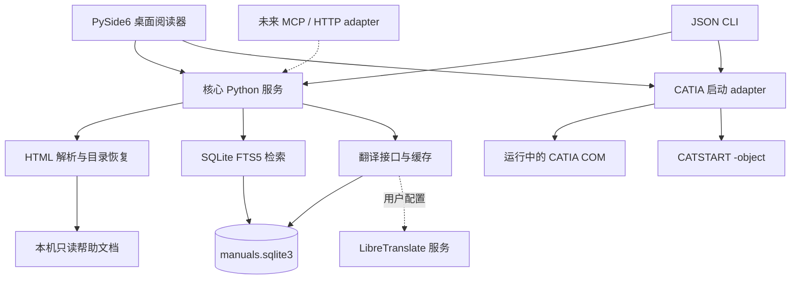

# CATIA V5 帮助文档查看器：分析与基本设计

日期：2026-10-29。阶段：环境与基础原型，后续迭代的设计基线。

## 1. 目标与边界

把本机 CATIA V5 帮助文档变成可以快速搜索、阅读、理解并打开配套模型的本地知识库。核心解析与检索能力独立于桌面界面，后续 agent、CLI、MCP 或本地 HTTP 服务复用同一份 Python API。

原始文档只读，索引与翻译缓存写入项目 `data/`。不复制整套帮助文件，不上传文档，不修改 CATIA 安装目录。模型依赖保持原来的相对目录，打开示例不把 CATProduct 单独拷走。

本轮交付是可运行的基础原型。完整中文翻译、中文搜索、生产级安装包和 CATIA 交互联调是后续工作，不能把术语命中视为整句翻译。

## 2. 本机调查结果

实际检查的路径：

- 文档根目录：`C:\UserApp\3D\DS\Dassault Systemes\B33doc\English`
- 入口：`CATIA_P3_homepage.htm`
- 启动器：`C:\UserApp\3D\DS\Dassault Systemes\B33\win_b64\code\bin\CATSTART.exe`
- 环境名称：`CATIA_P3.V5-6R2023.B33`
- 环境目录：`C:\UserApp\3D\DS\Dassault Systemes\CATEnv`

文件系统普查：

| 项目 | 观察结果 |
| --- | ---: |
| 文件总数 | 80,744 |
| `.htm` | 15,312 |
| HTML 合计 | 15,334（含 22 个 `.html`） |
| HTML 字节数 | 155,752,165，约 148.5 MiB |
| `online` 下含 HTML 的目录 | 364，包含公共资源和接口参考 |
| GIF / PNG | 50,062 / 4,524 |
| CATPart / CATProduct | 3,448 / 1,195 |
| CGR / MODEL / CATDrawing | 811 / 272 / 126 |
| CATScript | 218，作为脚本附件，不直接执行 |

入口页在 `onLoad` 中跳转到 `online/CATIA_P3_default.htm`。首页通过旧 JavaScript 控制导航，正文一般不依赖这些脚本。典型目录：

```text
English/
  CATIA_P3_homepage.htm
  online/
    CATIA_P3_default.htm
    icons_C2/                   # 公共图片、样式与旧脚本
    prtug_C2/                   # Part Design 手册
      prtugbt0501.htm           # Creating Pads
      prtugsm.htm               # 静态 Site Map
      prtugCATIAtoc.htm         # 顶层分类
      prtugsmfrs.htm            # frameset 外壳
      _navigation/prtugnav.htm  # Previous/Next 等导航
      index/ftindex.json        # 原始全文索引，存在 FileList、TitleList
      images/
      samples/Pad1.CATPart
```

`prtugsm.htm` 的 `p.sm1`、`p.sm2` 与 `margin-left:25/50/...` 可以恢复目录层级。`_navigation` 页面包含 `GoToBody('...')` 静态调用，可提取目标，不能执行任意脚本。

正文存在 UTF-8 和声明 `iso-8859-1` 的页面，使用 FrontPage 生成的表格、嵌套段落、命名锚点与相对图片。比如 `Creating Pads` 页直接链接 `samples/Pad1.CATPart`，真实文件存在。

这份文档同时包含自动化接口参考，单纯抓取首页链接会漏掉页面，因此首次索引扫描整个根目录的 HTML 文件。原始 JSON 索引可作为后续元数据补充，不依赖其专有搜索结构。

## 3. 技术决策

| 决策 | 采用方案 | 原因与限制 |
| --- | --- | --- |
| Python | 当前环境 3.12.14 x64，项目声明 3.12–3.14 | WindowsApps 的 python/py 别名执行失败；实际用户安装为 3.15.2，本轮不用它承载 Qt |
| HTML 解析 | BeautifulSoup + lxml | 容忍旧式与不完整 HTML，生成统一模型；不运行脚本 |
| 数据存储 | 标准库 sqlite3 + FTS5 | 单文件、无需服务，足以承载本机约 1.5 万页 |
| 英文搜索 | Porter + Unicode61，前缀索引，BM25 | 标题权重更高、精确标题优先；普通文本输入转义，拒绝 FTS 语法注入 |
| 桌面 GUI | PySide6 Widgets + Qt WebEngine | 旧手册大量图片和表格，浏览器引擎比纯富文本组件更适合保留内容布局 |
| CATIA 集成 | pywin32 COM，回退 CATSTART | 优先复用当前 CATIA 会话；启动参数独立配置 |
| 翻译 | Protocol + provider adapter + SQLite 缓存 | 默认术语辅助；LibreTranslate 可指向自建本机服务或用户指定服务 |
| agent 入口 | Python API + JSON CLI | 本轮不引入网络服务，未来只需薄适配层 |

FTS5 的 Unicode61 不等于中文分词器。原文索引不会因为装了 GUI 就具备中文搜索；后续需要术语查询扩展、中文分词/二元切词及译文索引。Trigram 对少于三个字符的查询存在限制，不能直接当作所有中文短词查询的解决方案。

## 4. 分层与依赖方向



模块职责：

- `core/models.py`：Document、Block、Link、SearchHit、TocEntry，数据结构不包含 Qt 类型。
- `core/paths.py`：相对 URL、URL 编码、锚点与文件类型识别；解析后必须落在文档根目录内。
- `core/parser.py`：编码处理、正文块、链接、标题、目录及静态阅读 HTML。
- `core/index.py`：数据模型落库、FTS 同步、增量索引、查询和结构化读取。
- `core/translation.py`：翻译协议、术语表、LibreTranslate 和按内容缓存。
- `integrations/catia.py`：文件校验、COM 复用、启动参数构造。
- `cli.py`：JSON 输入输出的命令适配层。
- `gui/app.py`：Qt 阅读、目录、搜索、选中文字翻译与示例操作。

CLI 的解析、检索、翻译和核心模块导入均不依赖 GUI。索引和翻译在后台线程执行，每个任务独立建立 SQLite 连接；SQLite 使用 WAL 与超时，避免跨线程共享 connection。阅读页解析目前在 UI 线程完成，若将来出现特别大的单页，可再异步化并加入 LRU 页面缓存。

## 5. 核心文档模型

```text
Document
  path             文档根目录下的规范化相对路径，稳定身份
  title / module   页面标题与所属模块
  kind             article / navigation / frameset
  encoding         读取时使用的编码
  content_hash     原始文件 SHA-256
  text             按阅读顺序提取的纯文本
  headings[]       章节标题
  blocks[]         {id, kind, text}
  links[]          {label, href, kind, target, fragment, exists}
```

Block ID 由文档路径、块序号与块内容生成，同一版本解析结果可重复。插入、删除块会影响其后块的 ID；当前不承诺跨版本恒定。agent 引用建议携带 `path + content_hash + block_id`。未来再把锚点、原始 DOM 路径、章节和操作步骤关联进块模型。

`Link.kind` 区分文档、模型示例、普通附件、外部链接和禁止链接。CATScript 不列入模型示例白名单，不能通过一键示例入口执行。文档内容和翻译均视为数据，agent 接入时不能把正文中的指令当系统指令。

## 6. 数据库与增量策略

| 表 | 内容 |
| --- | --- |
| `metadata` | 文档根路径绑定，避免不同安装混用同一索引 |
| `documents` | 页面路径、标题、模块、类别、编码、哈希、mtime、size、正文与结构化 JSON |
| `documents_fts` | 外部内容 FTS5 表，通过触发器与 documents 的插入/修改/删除同步 |
| `translations` | provider + target + source text 的 SHA-256 键、原文、译文与时间 |

`PRAGMA user_version=1` 记录 schema 版本，遇到未知版本直接报错。未来版本写显式迁移，不默默覆盖数据。

增量扫描先比较 `mtime_ns + size`，未变化就跳过；重新解析时计算 SHA-256。该优化不能识别“内容变化但时间与大小被原样保留”的情况，`index --force` 用于完整重新解析。每 100 页提交一次，中断后已提交的进度保留，下次继续。

完整扫描成功后才删除消失页面。限定 `--limit` 或发生解析错误时不清除旧记录；按模块扫描只清理该模块。解析失败的旧记录保留并在报告中列出，下一轮可重试。

当前 `read` 从原文重新解析，确保 agent 能读取未建索引的页面；`ManualIndex.get()` 可返回上次索引快照。索引报告、查询命中和读取结果都支持 JSON。无关导航页不参与默认搜索。

## 7. 阅读与目录

本轮保留正文的图片、表格、列表和锚点，并统一基础字体与样式；移除旧脚本、事件、frames、嵌入对象、外部样式和原来的内联样式。阅读器不是对旧首页做浏览器封装。

目录按模块懒加载，优先使用静态 Site Map 的顺序和层级，没有 Site Map 时回退到模块 HTML 列表。跨文档链接交回应用解析，模型链接交给 CATIA adapter。框架页尝试选择其正文 frame。通用 JavaScript 动态目录、复杂脚本链接和所有框架组合不在本轮完整支持范围内。

Qt WebEngine 禁用 JavaScript 和远程内容访问，并将本地资源约束在文档根目录与应用的 `data/rendered/` 缓存。规范化 HTML 写入该缓存后以本地 URL 加载，避免 `setHtml` 的 data URL 大小限制；实际接口总索引页超过 2 MB。解析后的原始链接仍保存在结构化模型，GUI 只呈现受控的本地内容。页面源文件与数据库不会被自动分享。

## 8. CATIA 示例打开流程

1. 解析链接为根目录内真实模型路径，保留文件名与目录，不搬移依赖。
2. 使用模型类型白名单并确认文件存在。
3. 工作线程初始化 COM，调用 `GetActiveObject('CATIA.Application')`。
4. 已有会话：`application.Documents.Open(path)`；失败明确报错，避免默默再起一个会话。
5. 没有会话：构造 argv，用 `subprocess.Popen(..., shell=False)` 启动：

```text
CATSTART.exe
  -run CNEXT.exe
  -env CATIA_P3.V5-6R2023.B33
  -direnv <CATEnv 路径>
  -nowindow
  -object <示例完整路径>
```

`-object` 的依据是本机官方帮助 `online/basug_C2/basugbt0101.htm` 的 “Method 5: Using the catstart Command”。Windows 带空格路径交给 subprocess 参数列表处理，不手写 shell 拼接。

本轮验证 argv 和模拟 COM 交互。启动命令提交成功不等于模型已加载成功；CATSTART 回退还需要在实际 CATIA 会话中验证许可证、权限、COM 注册以及模型依赖。当前不会从 CLI 默认启动 CATIA，需 `open --execute`；GUI 点击示例属于明确打开操作。

后续可增加打开到用户工作目录的“可编辑副本”模式，但 CATProduct 引用图必须整体处理。本轮直接打开安装目录内的源示例，用户修改后应另存为个人工作文件。

## 9. 中文与翻译路线

本轮：选中文字 → TranslationService → provider → 本地缓存 → 独立侧栏显示。默认 `GlossaryProvider` 仅返回 CAD 术语释义，并明确标记“非整句翻译”。`LibreTranslateProvider` 遵循 `/translate` 接口，读取环境变量中的 API key；只有显式配置该 provider 并触发翻译才向配置端点发送选中文字。

后续：

1. 选择翻译引擎：自建本机模型、LibreTranslate 或用户的模型 API。引擎能力、延迟与专业术语质量需要真实段落对比。
2. 建立可配置 CATIA 术语表，保留 `Pad Definition`、按钮、参数、文件名和 API 标识符。
3. 按段落/操作步骤翻译，保留图像和表格位置，提供中英对照与失败重试；按模型版本、术语版本与原文哈希隔离缓存。
4. 对译文建立单独的中文检索字段，并提供原文回溯。中文搜索可以先做术语扩展，再评估分词和混合检索。

目前适配器契约已用模拟 HTTP 测试；没有部署本地翻译模型，也没有实测某个真实服务的翻译质量。

## 10. 迭代与验收

| 阶段 | 验收目标 |
| --- | --- |
| 当前基础阶段 | 独立环境、设计、核心解析/索引/CLI、桌面原型、真实全库扫描与测试记录 |
| 下一阶段：可用性 | CATIA 两条启动路径联调，锚点与复杂 frames 回归，中文模块名称和更好的查询排序 |
| 中文阅读 | 确定 provider、术语表、分块双语阅读、翻译队列、中文搜索 |
| agent 接入 | 章节/步骤/资源结构完善，稳定引用，MCP tools 与只读本地 API；模型打开作为显式有副作用工具 |
| 交付 | 用户配置界面、索引迁移、日志、Windows 安装包、Qt/Chromium 与第三方许可证材料 |

建议的真实验收语料包括：Part Design、Assembly Design、Generative Shape Design、Sketcher、Automation interfaces；覆盖英文短词、文件名、跨模块跳转、2D/3D 示例、缺失附件、非 ASCII 字符和非常大的表格页。

## 11. 技术参考

- [SQLite FTS5 官方说明](https://www.sqlite.org/fts5.html)：tokenizer、前缀查询、BM25、trigram 限制与外部内容表。
- [Qt for Python 入门](https://doc.qt.io/qtforpython-6/gettingstarted.html)：PySide6 安装和虚拟环境。
- [QWebEngineView](https://doc.qt.io/qtforpython-6/PySide6/QtWebEngineWidgets/QWebEngineView.html)：HTML 阅读与页面加载。
- [QWebEnginePage](https://doc.qt.io/qtforpython-6/PySide6/QtWebEngineCore/QWebEnginePage.html)：链接导航拦截。
- [LibreTranslate `/translate`](https://docs.libretranslate.com/api/operations/translate/)：请求字段与 translatedText 返回值。
- CATIA 本机安装文档：`online/basug_C2/basugbt0101.htm`、`online/prtug_C2/prtugsm.htm` 与 `online/prtug_C2/prtugbt0501.htm`。
